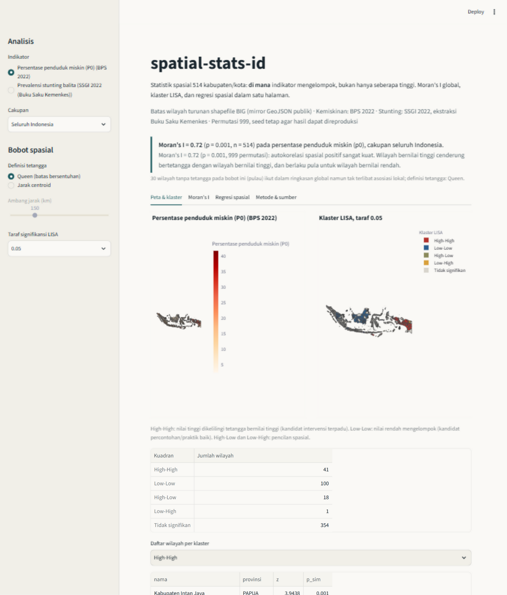

# spatial-stats-id

Statistik spasial 514 kabupaten/kota Indonesia untuk indikator wilayah (kemiskinan, stunting).
Angka rata-rata provinsi menyembunyikan konsentrasi; dashboard ini menjawab **di mana** indikator
mengelompok lewat Moran's I global, klaster LISA, dan regresi spasial, dengan geometri turunan
shapefile resmi BIG dan indikator dari BPS serta SSGI.



Demo: jalankan lokal dulu (lihat Mulai cepat). Tautan Streamlit Community Cloud diisi setelah deploy.

## Mulai cepat

```bash
git clone <url-repo-anda> && cd spatial-stats-id
python -m venv .venv && .venv/Scripts/pip install -e ".[pipeline,dev]"   # Linux/mac: .venv/bin/pip
streamlit run app.py
```

Tidak perlu kunci API dan tidak perlu jaringan saat berjalan: seluruh artefak data sudah dikomit.

## Apa yang dihitung

| Tab | Isi |
| --- | --- |
| Peta & klaster | Peta indikator dan peta kuadran LISA (High-High, Low-Low, High-Low, Low-High), daftar wilayah per klaster, ekspor CSV |
| Moran's I | Nilai I global, p-value permutasi, scatterplot z terhadap rata-rata tetangga |
| Regresi spasial | OLS vs ML_Lag vs ML_Error, uji rasio likelihood, kovariat BPS pilihan pengguna |
| Metode & sumber | Penjelasan naratif, catatan kejujuran data, referensi |

Kontrol: indikator (kemiskinan BPS 2022 / stunting SSGI 2022), cakupan nasional atau per provinsi,
pembobot spasial (Queen atau jarak centroid 100-300 km), taraf signifikansi. Permutasi 999 dengan
seed tetap sehingga angka dapat direproduksi. Runtime sengaja ringan: geometri sudah disederhanakan
untuk tampilan, tetangga dihitung dari geometri penuh, tanpa geopandas saat dashboard berjalan.

## Data dan kejujuran

| Sumber | Isi | Lisensi |
| --- | --- | --- |
| Buku Saku Hasil SSGI 2022 (Kemenkes) | Prevalensi stunting balita 492 kab/kota | publikasi resmi |
| Tabel BPS 2022 (via dataset publik, Apache 2.0) | P0 kemiskinan, IPM, RLS, pengeluaran per kapita, sanitasi, air, TPT, PDRB | Apache 2.0 |
| Mirror GeoJSON turunan shapefile BIG | batas administrasi 514 kab/kota | data geospasial BIG |

Catatan penting:

- SSGI 2022 tidak menerbitkan angka kab/kota untuk 22 wilayah NTT; dashboard menampilkannya sebagai
  data tidak tersedia, bukan nol.
- Tabel BPS 2022 memakai nama lama "Pontianak" untuk Kabupaten Mempawah; keduanya digabung.
- Nilai stunting dibaca dari grafik resmi (presisi 0,1 poin) dan divalidasi silang dengan publikasi
  resmi: Asmat 54,5% (tertinggi nasional) dan Kota Batu 4,8% cocok persis.
- Satu batang buku SSGI salah label ("Puncak Jaya" dua kali); pemisahan dua nilai diverifikasi
  lewat publikasi Rembuk Stunting Papua Tengah (Puncak Jaya = 42,5%).
- Dashboard edukatif; bukan dokumen resmi penetapan kebijakan. Untuk penggunaan formal, cocokkan ke
  SSGI dalam Angka dan publikasi BPS.

## Struktur proyek

```
app.py                     dashboard Streamlit
src/spatial_stats_id/      nama.py, data.py, weights.py, spasial.py
scripts/
  fetch_sources.py         unduh sumber mentah (geometri, PDF SSGI, CSV BPS)
  extract_ssgi.py          PDF Buku Saku -> CSV stunting (pembacaan grafik)
  build_geodata.py         bersihkan + sederhanakan geometri + tetangga Queen
  build_indicators.py      normalisasi nama -> join kode -> CSV processed
  fetch_bps.py             klien WebAPI BPS untuk pembaruan (butuh kunci gratis)
data/processed/            artefak dikomit (dibaca dashboard)
tests/                     23 pengujian (nama, bobot, statistik, data, klien BPS)
```

## Reproduksi data dari nol

```bash
python scripts/fetch_sources.py
python scripts/build_geodata.py data/sources/all_kabkota_ind.geojson
python scripts/extract_ssgi.py data/sources/buku_saku_ssgi_2022.pdf -o data/ssgi_stunting_2022_raw.csv
python scripts/build_indicators.py data/sources/indikator_bps_2022.csv data/ssgi_stunting_2022_raw.csv
pytest tests/ -q
```

Seluruh pipeline di atas dijalankan dan diverifikasi pada laptop 8 GB yang sama: geometri mentah
10 MB, artefak yang dikomit sekitar 3,5 MB, dan setiap langkah selesai dalam hitungan detik.

## Menyegarkan indikator lewat WebAPI BPS

1. Registrasi kunci gratis di webapi.bps.go.id/documentation.
2. `export BPS_API_KEY=...` lalu jalankan:

```bash
python scripts/fetch_bps.py --var <id-variabel> --th 2024 --out data/bps_cache/indikator.csv
```

3. Gabungkan hasil ke master wilayah dengan logika `build_indicators.py`, lalu komit snapshot baru.

## Deploy ke Streamlit Community Cloud

1. Push repositori ini ke GitHub.
2. Di share.streamlit.io: New app, pilih repo, branch `main`, Main file path `app.py`.
3. Selesai; `requirements.txt` sudah ter-pin dan aplikasi hanya membaca artefak komit.
   RAM bebas-tier cukup karena tidak ada geopandas saat runtime.

## Pengujian dan CI

```bash
pytest tests/ -q
```

GitHub Actions menjalankan suite yang sama di setiap push (`.github/workflows/ci.yml`).

## Roadmap

- Geometri langsung dari unduhan resmi BIG (tanpa mirror) begitu proses unduh manual dilakukan.
- SSGI 2024 untuk provinsi (kab/kota belum terbit) sebagai pembanding tren.
- Indikator tambahan (IPM detail, pendidikan) lewat WebAPI BPS.
- Mobilitas wilayah: peta klaster interaktif per tahun bila seri panjang tersedia.

## Lisensi

MIT untuk kode. Data mengikuti ketentuan masing-masing sumber (lihat tabel di atas).
